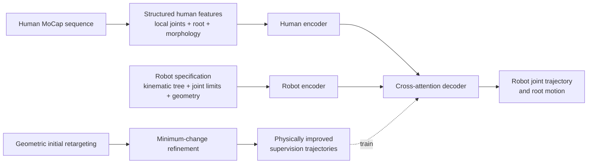

# MaMoRetarget: Morphology-Aware Human-to-Robot Motion Retargeting

<p align="center">
  <a href="https://github.com/nubot-nudt/MaMoRetarget">
    
  </a>
  <a href="https://doi.org/10.1145/3767308.3835681">
    
  </a>
  <a href="LICENSE">
    
  </a>
</p>

Official implementation of **MaMoRetarget**, a two-stage framework for fast, morphology-aware human-to-robot motion retargeting across different humanoid embodiments.

📄 **Paper:** [MaMoRetarget: Morphology-Aware Human-to-Robot Motion Retargeting Across Humanoid Embodiments](net/shen2026mm_camera_ready.pdf)  
🌐 **Project repository:** [nubot-nudt/MaMoRetarget](https://github.com/nubot-nudt/MaMoRetarget)

## Highlights

- **Minimum-change refinement:** repairs collision-prone local kinematic chains with discrete local search while preserving motion semantics and temporal continuity.
- **Morphology-aware network:** combines a human motion encoder, a kinematic-tree robot specification encoder, and a cross-attention decoder with explicit joint-limit handling.
- **Unified multi-robot training:** conditions one feed-forward model on robot topology, joint attributes, limits, and link geometry.
- **Fast inference:** the paper reports 6,301 FPS for MaMoRetarget (Ours-M), compared with 30 FPS for the frame-wise GMR baseline on the same evaluation setup.
- **Three humanoid embodiments:** Unitree G1, Booster T1, and Fourier N1.



## Repository scope

The main paper implementation is in `net/`. The repository also contains the GMR-based preprocessing pipeline, robot descriptions, example motion data, generated labels, and evaluation utilities used by the experiments.

| Path | Description |
| --- | --- |
| `net/train_retarget_multirobot_sepinputs.py` | Train the morphology-aware multi-robot model |
| `net/eval_retarget_multirobot_sepinputs.py` | Evaluate a saved checkpoint on validation data |
| `net/bvh_dir_retarget_multirobot_net_save.py` | Retarget a directory of BVH motions |
| `net/amass_npz_retarget_multirobot_sepinputs_save.py` | Retarget AMASS/SMPL-X `.npz` motions |
| `net/worknet/` | Human encoder, robot encoder, decoder, robot specifications, and robot JSON configs |
| `net/dataset/` | PKL input/label data arranged by robot and train/validation split |
| `net/morph_out/` | Human morphology vectors used as conditioning inputs |
| `net/robot_spec_*.npz` | Robot morphology and kinematic specifications |
| `general_motion_retargeting/` | GMR preprocessing and motion-retargeting utilities |
| `scripts/` and `tools/` | Data conversion, visualization, collision, and metric utilities |
| `net/shen2026mm_camera_ready.pdf` | Camera-ready paper |

The `net/dataset.zip` archive contains the generated training data used by the network experiments. The repository also includes a smaller set of example motions under `lafan1/` and `AMASS/`; large datasets and body models may be subject to their original licenses.

## Supported robots

The main experiments in the paper use the following robot specifications. The output joint order is the order stored in the corresponding `robot_spec_*.npz` file.

| Robot | Config name | DoF used in the paper | Specification |
| --- | --- | ---: | --- |
| Unitree G1 | `g1` | 29 | [`net/worknet/robot_spec_g1.npz`](net/worknet/robot_spec_g1.npz) |
| Booster T1 | `t1` | 27 | [`net/worknet/robot_spec_t1.npz`](net/worknet/robot_spec_t1.npz) |
| Fourier N1 | `n1` | 23 | [`net/worknet/robot_spec_n1.npz`](net/worknet/robot_spec_n1.npz) |

The JSON files in `net/worknet/` describe which input, label, morphology, and robot-specification files are used for each robot. They can be copied and edited to add another embodiment with a compatible robot specification.

## Requirements

The experiments were run on Ubuntu with Python 3.10 and a single NVIDIA RTX 4090D (24 GB). A CUDA-capable GPU is recommended for training and high-throughput inference.

- Python `>= 3.10`
- PyTorch with a CUDA version compatible with your driver
- MuJoCo and the packages listed in [`setup.py`](setup.py)
- SMPL-X body models for AMASS/SMPL-X inference

Other versions may work, but preprocessing, MuJoCo collision checks, and saved checkpoints can be sensitive to environment versions.

## Installation

```bash
git clone https://github.com/nubot-nudt/MaMoRetarget.git
cd MaMoRetarget

conda create -n mamoret python=3.10 -y
conda activate mamoret

# Install a PyTorch build appropriate for your CUDA driver first.
# See https://pytorch.org/get-started/locally/ for the matching command.

pip install -e .
```

For AMASS/SMPL-X inference, place the SMPL-X body models under `assets/body_models/`. The expected directory is:

```text
assets/body_models/
└── smplx/
    ├── SMPLX_NEUTRAL.npz
    ├── SMPLX_FEMALE.npz
    └── SMPLX_MALE.npz
```

## Data layout

The network dataset uses one input directory and one refined label directory per robot. The default configuration in [`net/worknet/robots_sepinputs.json`](net/worknet/robots_sepinputs.json) expects paths relative to `net/`:

```text
net/
├── dataset/<robot>/train/input/*.pkl
├── dataset/<robot>/train/output/*_refine.pkl
├── dataset/<robot>/val/input/*.pkl
├── dataset/<robot>/val/output/*_refine.pkl
├── morph_out/human_morphology_targets_<robot>.npz
└── worknet/robot_spec_<robot>.npz
```

Each human-motion input PKL contains the local body positions and rotations, root position and rotation, body names, and optionally the frame rate. The dataset loader converts these fields to:

- `X_joint`: `(L, 14, 12)` by default — local position (3), 6D rotation (6), and velocity (3);
- `X_root`: `(L, 12)` by default — root position (3), 6D rotation (6), and velocity (3);
- `m_h`: a static human morphology vector.

Each refined robot label provides the target joint trajectory `Y_dof` and root trajectory `Y_root`. Windows are sliced within each motion file, so a training window never crosses a PKL boundary.

To use your own motions, generate the human input PKLs and refined robot labels with matching file stems, then update the paths and robot entries in a copy of `robots_sepinputs.json`. The default label suffix is `_refine`.

## Quick start

All commands below are run from `net/`, because the supplied JSON files use paths relative to that directory.

### 1. Train on G1, T1, and N1

```bash
cd net
python3 train_retarget_multirobot_sepinputs.py \
  --robots_json worknet/robots_sepinputs.json \
  --out_dir ckpt_mamoret \
  --clip_len 64 \
  --stride 16 \
  --batch_size 16 \
  --epochs 50 \
  --lr 3e-4 \
  --min_lr 1e-6 \
  --amp
```

The trainer writes `best.pt`, `last.pt`, and training metadata to `ckpt_mamoret/`. Use `--mix_mode per_robot`, `roundrobin`, or `weighted` to change how robot datasets are sampled.

### 2. Evaluate a checkpoint

```bash
python3 eval_retarget_multirobot_sepinputs.py \
  --robots_json worknet/robots_sepinputs.json \
  --out_dir ckpt_mamoret \
  --ckpt best \
  --use_ckpt_args \
  --batch_size 16
```

`--use_ckpt_args` is recommended so that the evaluation feature and architecture settings match the checkpoint used for training.

### 3. Retarget a BVH directory

```bash
python3 bvh_dir_retarget_multirobot_net_save.py \
  --bvh_dir ../lafan1/bvh_test \
  --out_dir ../retargeting_result/mamoret_bvh \
  --ckpt ckpt_mamoret/best.pt \
  --robots_json worknet/robots_sepinputs.json \
  --clip_len 64 \
  --stride 16 \
  --amp \
  --overwrite
```

Outputs are saved as robot-specific PKLs under `../retargeting_result/mamoret_bvh/<robot>/`.

### 4. Retarget an AMASS/SMPL-X motion

```bash
python3 amass_npz_retarget_multirobot_sepinputs_save.py \
  --smplx_file ../AMASS/85/85_11_stageii.npz \
  --body_model_dir ../assets/body_models \
  --out_dir ../retargeting_result/mamoret_amass \
  --ckpt ckpt_mamoret/best.pt \
  --robots_json worknet/robots_sepinputs.json \
  --use_ckpt_args \
  --amp \
  --overwrite
```

Omit `--robot` to infer all robots listed in the JSON file. Add `--smplx_dir` to process a directory of AMASS/SMPL-X files.

## Evaluation summary

The paper evaluates collision behavior and temporal smoothness in MuJoCo, cross-robot generalization, downstream policy learning with BeyondMimic in Isaac Sim, and runtime. The main observations are:

- minimum-change refinement substantially reduces collision frames and penetration depth in the generated supervision trajectories;
- MaMoRetarget produces smoother trajectories than the frame-wise refined pipeline in the jerk-RMS comparison;
- joint training on G1, T1, and N1 improves cross-embodiment prediction compared with single-robot training;
- MaMoRetarget obtains the strongest overall downstream policy success in the reported comparison and reaches 6,301 FPS in the runtime experiment.

See Tables 1–5 and Figures 5–6 in the [paper](net/shen2026mm_camera_ready.pdf) for the complete numbers and hardware-execution results.

## Citation

If you use this code or the MaMoRetarget method, please cite:

```bibtex
@inproceedings{shen2026mamoretarget,
  title     = {MaMoRetarget: Morphology-Aware Human-to-Robot Motion Retargeting Across Humanoid Embodiments},
  author    = {Shen, Yehui and Chen, Xieyuanli and Shi, Chenghao and Xie, Zheng and Xiao, Junhao and Zeng, Zhiwen and Lu, Huimin},
  booktitle = {Proceedings of the 34th ACM International Conference on Multimedia},
  year      = {2026},
  doi       = {10.1145/3767308.3835681}
}
```

## License and acknowledgements

The code in this repository is released under the [MIT License](LICENSE). GMR, SMPL-X, LAFAN1, AMASS, MuJoCo, robot assets, and other bundled components retain their respective upstream licenses. Please follow the terms of each source dataset and robot model before redistribution or deployment.

This work was supported by the grants listed in the paper. We thank the authors of GMR, SMPL-X, LAFAN1, AMASS, BeyondMimic, and the robot asset providers for their open-source resources.
